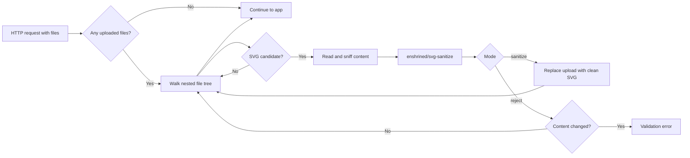

# arif_ca/svg-upload-security

**Secure SVG file uploads in Laravel** by inspecting every uploaded file on incoming HTTP requests, detecting SVG content (including disguised uploads), and either **sanitizing** malicious markup or **rejecting** files that are not safe.

SVG is a common format for logos, icons, and illustrations, but treating it like a passive image (PNG/JPEG) is a serious mistake. This package adds a dedicated layer **before your controllers and validation rules run**, so storage, image pipelines, and admin previews never receive an unchecked SVG.

---

## Why SVG upload security matters

SVG files are **XML documents**, not bitmaps. Browsers parse and execute much of what is inside an SVG when it is served or embedded. That makes user-supplied SVG a classic **stored XSS** vector if you only check the file extension or `Content-Type`.

Attackers routinely hide payloads in otherwise innocent-looking graphics:

| Risk | What attackers try | Why it hurts |
|------|-------------------|--------------|
| **Script execution** | `<script>`, event handlers (`onload=`), `javascript:` URLs | Runs in the victim’s browser in your site’s origin |
| **HTML injection via SVG** | `<foreignObject>` with HTML inside | Bypasses naive “image only” assumptions |
| **External resources** | `<use href="https://…">`, remote fonts/images | Tracking, mixed content, or chained attacks |
| **Metadata spoofing** | Upload `evil.php` or `logo.png` that contains `<svg>…` | Bypasses extension/MIME allow-lists |

Typical vulnerable flows:

1. User uploads an SVG to a profile or CMS field.
2. The app stores the file and serves it from `/storage` or a CDN **with an image MIME type**.
3. Another user (or an admin) opens the “image” URL; the browser interprets it as SVG/XML and runs embedded script.

Checking `mimes:svg` or validating file size **does not remove** script tags, foreign objects, or dangerous URLs. You need **content-aware sanitization** (or strict rejection) at upload time.

This package wraps the battle-tested **[enshrined/svg-sanitize](https://github.com/darylldoyle/svg-sanitizer)** library in Laravel middleware so every upload is processed consistently across routes and nested form fields.

---

## What this package does



- **Automatic registration** (default): middleware is prepended to the HTTP kernel so it runs early on requests that include files.
- **Detection**: MIME type, client extension, and optional **content sniffing** (first ~4KB for `<svg` / XML wrapper).
- **Sanitization**: strips disallowed elements/attributes, with **remote references removed** (`removeRemoteReferences(true)`).
- **Transparent to controllers**: in `sanitize` mode, dangerous uploads are replaced with a cleaned `UploadedFile` before your code runs; non-SVG files are untouched.
- **Nested uploads**: supports nested multipart keys such as `avatar`, `gallery.0`, or `documents.invoice.file`.

Non-SVG uploads are ignored. SVG uploads that fail checks throw a **`ValidationException`** with a configurable message (and optional structured logging).

---

## Requirements

- PHP **8.2+**
- Laravel **11**, **12**, or **13** (Illuminate HTTP, routing, support, validation components)
- Composer

`enshrined/svg-sanitize` (**^1.1.1**) is installed automatically as a dependency of this package.

---

## Installation

```bash
composer require arif_ca/svg-upload-security:^1.0
```

Packagist publishes **stable** versions from [Git tags](https://github.com/arif-ca-solutions/svg-scanner/tags) (for example `v1.0.0`). If you need the latest `main` before a release, use:

```bash
composer require arif_ca/svg-upload-security:1.x-dev
```

Laravel auto-discovers `SvgUploadSecurityServiceProvider`. No manual registration is required.

### Local / monorepo development

```json
"repositories": [{ "type": "path", "url": "packages/svg-upload-security" }],
"require": { "arif_ca/svg-upload-security": "@dev" }
```

### Publish configuration (optional)

```bash
php artisan vendor:publish --tag=svg-upload-security-config
```

This copies `config/svg-upload-security.php` into your app so you can tune MIME lists, modes, and logging.

---

## Usage

### Default (recommended for most apps)

With defaults, the package:

1. Enables middleware globally (`SVG_UPLOAD_SECURITY_GLOBAL_MIDDLEWARE=true`).
2. Uses **`sanitize`** mode: malicious content is stripped; the request continues with a safe file.
3. Sniffs file content for hidden SVG (`SVG_UPLOAD_SECURITY_SNIFF_CONTENT=true`).

No route changes are needed. Any controller, Form Request, or Livewire upload that reads `$request->file(...)` receives already-sanitized SVGs.

### Route-only / opt-in middleware

For APIs that never accept files, or to limit overhead, disable global registration:

```env
SVG_UPLOAD_SECURITY_GLOBAL_MIDDLEWARE=false
```

Apply the middleware alias only where uploads occur:

```php
use Illuminate\Support\Facades\Route;

Route::post('/upload', UploadController::class)->middleware('sanitize.svg');

Route::middleware(['auth', 'sanitize.svg'])->group(function () {
    Route::post('/settings/avatar', [ProfileController::class, 'updateAvatar']);
});
```

The alias **`sanitize.svg`** is registered by the service provider.

### Disable entirely

```env
SVG_UPLOAD_SECURITY_ENABLED=false
```

---

## Operating modes

| Mode | Env value | Behavior | Best for |
|------|-----------|----------|----------|
| **Sanitize** | `sanitize` (default) | Run sanitizer; if output differs, **replace** the upload with cleaned SVG | Production apps that must accept user SVG (avatars, CMS, icons) |
| **Reject** | `reject` | If sanitization **would change** the file, **fail** the request | High-trust or admin-only uploads where any modification indicates an attack |

In **reject** mode, byte-identical output (after whitespace normalization) passes without replacing the file.

---

## Configuration reference

Environment variables map to `config/svg-upload-security.php`:

| Variable | Default | Description |
|----------|---------|-------------|
| `SVG_UPLOAD_SECURITY_ENABLED` | `true` | Master switch for middleware |
| `SVG_UPLOAD_SECURITY_MODE` | `sanitize` | `sanitize` or `reject` |
| `SVG_UPLOAD_SECURITY_GLOBAL_MIDDLEWARE` | `true` | Prepend middleware on the HTTP kernel |
| `SVG_UPLOAD_SECURITY_SNIFF_CONTENT` | `true` | Detect SVG by content, not only MIME/extension |
| `SVG_UPLOAD_SECURITY_LOG` | `false` | Log rejections to a Laravel log channel |
| `SVG_UPLOAD_SECURITY_LOG_CHANNEL` | `stack` | Channel used when logging is enabled |

Config file options (after publish):

| Key | Purpose |
|-----|---------|
| `mime_types` | Server/client MIME types treated as SVG (default: `image/svg+xml`, `image/svg`) |
| `extensions` | Extensions treated as SVG (default: `svg`, `svgz`) |
| `validation_message` | Message shown when an upload is rejected |
| `logging.enabled` / `logging.channel` | Structured warning log entry `svg_upload_rejected` with IP, user, path, reason |

Example `.env` for a strict admin portal:

```env
SVG_UPLOAD_SECURITY_MODE=reject
SVG_UPLOAD_SECURITY_LOG=true
SVG_UPLOAD_SECURITY_LOG_CHANNEL=security
```

---

## What gets rejected or cleaned

Processing uses **enshrined/svg-sanitize**, which removes or neutralizes typical SVG-based XSS primitives (scripts, dangerous attributes, and other disallowed tags per the sanitizer rules). This package additionally:

- Rejects **empty** or unreadable files.
- Rejects files that **claim to be SVG** (MIME/extension) but **do not contain** valid SVG-like content when sniffing is enabled.
- Rejects sanitization that yields **no safe content**.
- Enables **`removeRemoteReferences(true)`** so external URLs inside the SVG are not kept.

Your controllers should still apply normal validation (`required`, `file`, `max:…`) and authorization. This package focuses on **content security**, not business rules.

---

## Example: controller after middleware

Middleware runs first; you keep familiar Laravel code:

```php
public function store(Request $request)
{
    $request->validate([
        'logo' => ['required', 'file', 'mimes:svg', 'max:512'],
    ]);

    $path = $request->file('logo')->store('logos', 'public');

    return back()->with('path', $path);
}
```

If a user posted a script-laden SVG, **`sanitize` mode** already replaced the upload before `validate()` and `store()` — the stored object on disk should be the cleaned SVG.

---

## Security logging

When `SVG_UPLOAD_SECURITY_LOG=true`, rejected uploads emit a **warning** log entry:

- Event key: `svg_upload_rejected`
- Fields: `ip`, `user_agent`, `user_id` (if authenticated), `path`, `method`, `reason`

Use this for monitoring, SIEM alerts, or auditing repeated abuse attempts.

---

## Architecture notes

| Component | Role |
|-----------|------|
| `SanitizeSvgUploads` | HTTP middleware; walks files, swaps sanitized uploads, maps exceptions to validation errors |
| `SvgUploadProcessor` | Detection, sanitization, mode handling, temp file replacement |
| `RequestFileTree` | Recursive walk/replace for nested `UploadedFile` arrays |
| `UnsafeSvgUploadException` | Internal signal converted to a user-safe validation message |

The processor is bound as a **singleton** and reads mode from config on resolution.

---

## Limits and out of scope

Understanding these boundaries helps you design a complete upload strategy:

- **Multipart file uploads only** — does not decode base64 `data:image/svg+xml` fields in JSON or HTML; sanitize those in your domain layer if you accept them.
- **Not a substitute for CSP** — still serve user content with a strong **Content-Security-Policy** and avoid inline script where possible.
- **Not antivirus** — does not scan for malware in non-SVG binaries; combine with MIME verification and storage outside the web root where appropriate.
- **Serving strategy** — prefer serving sanitized SVGs with correct headers; consider `Content-Disposition: attachment` for downloads if inline display is not required.
- **Other stacks** — Node/Next.js and similar frameworks need their own SVG pipeline (e.g. server-side sanitizer or disallow SVG uploads).

---

## Recommended practices alongside this package

1. **Keep SVG uploads off by default** unless the product truly needs them; use PNG/WebP for untrusted users.
2. **Use `reject` mode** for small admin-only surfaces; use **`sanitize`** for public-facing uploads.
3. **Store on a separate domain or path** (cookieless asset host) to reduce impact if a bypass ever occurs.
4. **Do not rely on extension alone** — leave content sniffing enabled in production.
5. **Monitor** rejection logs for spikes (automated probing).

---

## License

MIT — see `composer.json`.

## Credits

Sanitization powered by [enshrined/svg-sanitize](https://github.com/darylldoyle/svg-sanitizer) (Daryll Doyle et al.).
